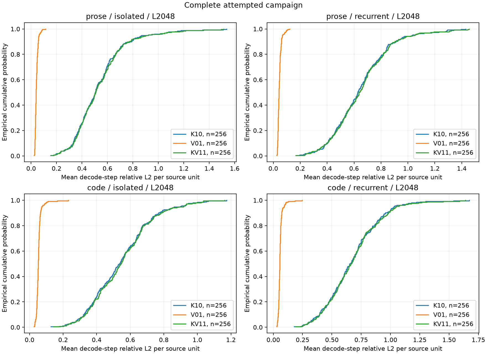

# Completed independent-source H200 collection — 2026-10-18

Run `46f7c2fa18e3d9c7` finished at **2026-10-18 12:44:40 UTC**. It collected all 1,152 planned conditions: 1,024 BF16 conditions on 512 source units and a paired 128-condition FP32 audit on a prespecified subset of 64 of those units. There were no execution or no-op control failures. Successful collection does not mean all fidelity thresholds passed.

## Results and acceptance criteria

| Check | Observed result |
|---|---:|
| Source units | 256 WikiText article titles + 256 Python project-name families |
| BF16 source/context conditions | 1,024/1,024 collected |
| FP32 source/context audit conditions | 128/128 collected |
| Exact passthrough/replay comparisons | 36,864/36,864 |
| Packing-equivalence comparisons | 18,432/18,432 exact |
| Isolated/recurrent first-step comparisons | 6,912/6,912 exact |
| Cross-dtype input-identity pairs | 128/128 |
| Native cached/full fidelity, BF16 | 571 pass, **453 fail** |
| Native cached/full fidelity, FP32 audit | 128 pass, 0 fail |
| Document-level treatment records | 13,824 repeated-measure rows; **not** 13,824 independent samples |

The dense native cached/full gate requires finite logits and relative L2 <= 0.025 at every one of eight decode steps. This is separate from the exact no-op, snapshot immutability and first-step history controls. Failed dense-fidelity rows remain in the published condition index and document CSV; they were not relabelled as fidelity passes. The treatment endpoint uses the native cached path as its reference. Comparisons to full native recomputation were retained in the original server trajectories. Passing the FP32 audit does not by itself establish the cause of every BF16 failure.

For the prespecified BF16 L2048 confirmatory endpoint, each source contributes its mean logit-relative-L2 across eight steps. The paired contrast is **K-only minus V-only**, in relative-L2 units (not task-error percentage points):

| Domain | Cache regime | Paired source n | Mean difference | 98.75% bootstrap interval |
|---|---|---:|---:|---|
| Prose | Isolated | 128 | 0.49639 | [0.44918, 0.55124] |
| Prose | Recurrent | 128 | 0.59733 | [0.54639, 0.64800] |
| Code | Isolated | 128 | 0.49382 | [0.45359, 0.53180] |
| Code | Recurrent | 128 | 0.61227 | [0.56333, 0.66040] |

All four intervals are positive in this bounded experiment. They support larger K-only logit perturbations than V-only under this quantizer, model and intervention. They do not show that SCOPE improves model accuracy. Intervals use 5,000 document-block percentile bootstrap resamples; four prespecified contrasts use nominal Bonferroni family confidence of 95%, subject to bootstrap approximation and residual source dependence. Other comparisons are exploratory.



## Data and provenance

- [Condition index](../results/population/46f7c2fa18e3d9c7/condition_index.csv): every planned condition, execution status, dense fidelity, controls and frozen-input hash.
- [Document treatment metrics](../results/population/46f7c2fa18e3d9c7/analysis/document_metrics.csv): complete document-level relative L2, KL, top1 agreement and natural-continuation NLL differences.
- [Factorial interaction](../results/population/46f7c2fa18e3d9c7/analysis/document_factorial.csv): direct vector interaction, aggregated within source.
- [Primary contrasts](../results/population/46f7c2fa18e3d9c7/analysis/primary_confirmatory.json), [exploratory paired contrasts](../results/population/46f7c2fa18e3d9c7/analysis/paired_contrasts.json), [distributions](../results/population/46f7c2fa18e3d9c7/analysis/distributions.json).
- [Input-source metadata](../results/population/46f7c2fa18e3d9c7/input_sources.json), [campaign](../results/population/46f7c2fa18e3d9c7/campaign.json), [final integrity audit](../results/population/46f7c2fa18e3d9c7/FINAL_INTEGRITY.json).

Executed server source commit: `685b16d22d9a20c656f2cf5c51fe10280e725967`. The published `scope/*.py` and `tests/*.py` match the executed source content hash `c072fa01688f90f2d516725d60b01c3d11ac7e380472823a21fe0164db066947`. README, dependency metadata, CI and the CPU artifact verifier were added/updated for publication after collection. This is not a new GPU run. Source changes or a different Git HEAD produce a different run identifier.

The complete original server export SHA256 is `c0cfb3ddd7e3a955d3c5d49fe404a8814571ec3ee0a6eeec26a6f31a1d155ac5`. Original per-step trajectories, exact input token IDs, condition manifests and the eight retained raw-logit files remain under the run directory on the execution server. The public package contains their audited summaries, hashes and source provenance; it does not contain weights, raw tensors, credentials or full source-text/token dumps. Artifact verification is an integrity/consistency audit, not independent GPU replication.

## Reproduction

For a CPU-only verification of the published evidence:

```bash
python scripts/verify_population_artifacts.py
```

The collection used Linux, Python 3.12.3, CUDA-enabled PyTorch 2.14.1+cu130, Transformers 5.19.0, NumPy 2.5.4 and one H200. The tests passed 39/39 before collection. CPU CI installs its own PyTorch; it does not reproduce H200 measurements. In an isolated environment with the required CUDA PyTorch already installed:

```bash
python -m pip install -e ".[test,research]"
python -m pytest -q
```

The GPU runner uses `local_files_only=True`. Cache Qwen/Qwen2.5-1.5B-Instruct at revision `989aa7980e4cf806f80c7fef2b1adb7bc71aa306` first. The input sampler downloads the two pinned public dataset shards listed in `input_sources.json`; it refuses to overwrite an existing frozen manifest. It uses an actual 2,057-token window per source, and the 512/2,048 contexts share the same natural continuation. For a fresh clean checkout:

```bash
python -m scope.population_inputs
python scripts/verify_population_artifacts.py --inputs data/population_v1/manifest.json
python -m scope.population run --smoke
# Inspect the smoke controls before starting the complete collection.
python -m scope.population run
```

The sampler's original whole-manifest hash includes the original machine's cache paths. The portable check compares selected source metadata, dataset file hashes and per-document token-window hashes, rather than requiring those machine paths to match. Run commands above describe the exercised entrypoints; rerunning at a new publication HEAD is not a replay of the original directory/run ID. The runner enforces one sequential worker, a shared own-worker lock, HBM/disk gates and an eight-hour campaign bound. It stores results on the server and does not need GitHub push authentication.

## Limits

One model, one window per eligible source and bounded public dataset shards do not establish broad model/workload coverage. Repository basename grouping and duplicate filtering reduce repeated sources but do not prove independent upstream lineage; related article topics may also remain dependent. Steps, heads, context lengths, dtypes and treatments are repeated measures. Q95 is descriptive; reliable extreme-tail/Q99 claims are not made. NLL uses only eight natural target tokens per source, not a corpus perplexity benchmark.

These interventions preserve dense KV residency and native prefill. Packing equality is an implementation check; it is not evidence of a packed-resident cache, a latency benefit, increased resident capacity or a serving-quality gain. Historical pilot/controlled-ablation evidence is retained separately.
